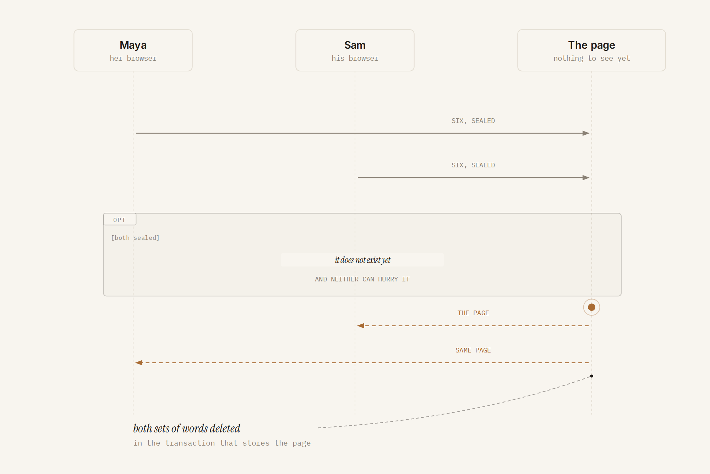
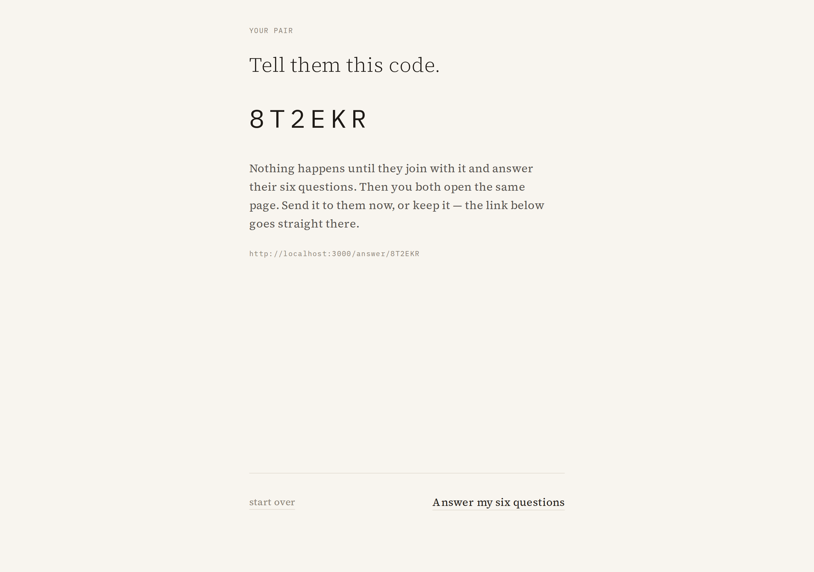
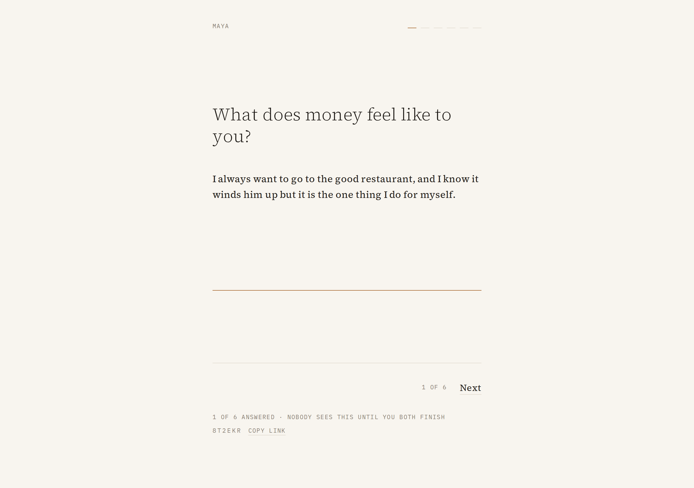
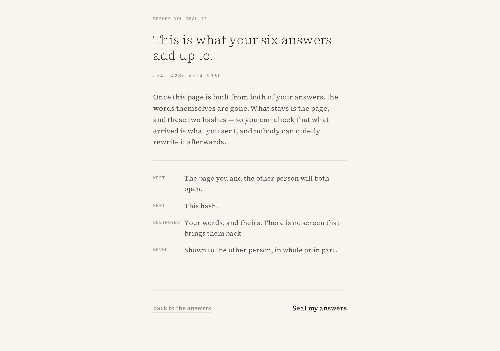
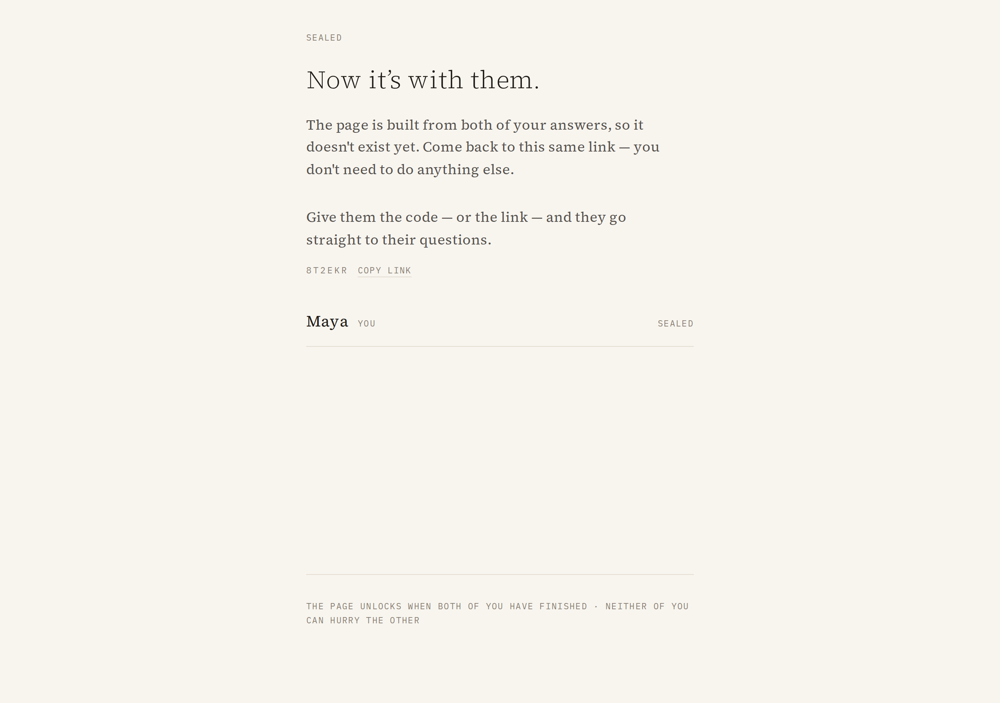
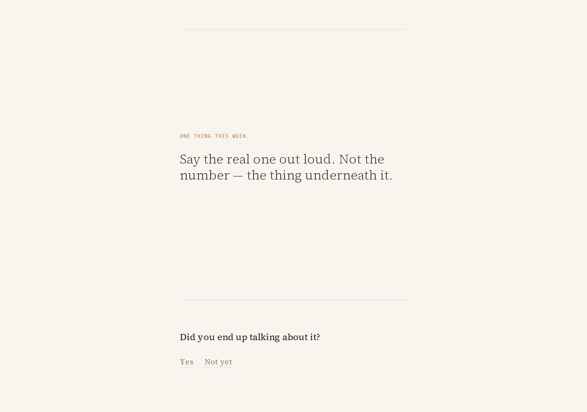
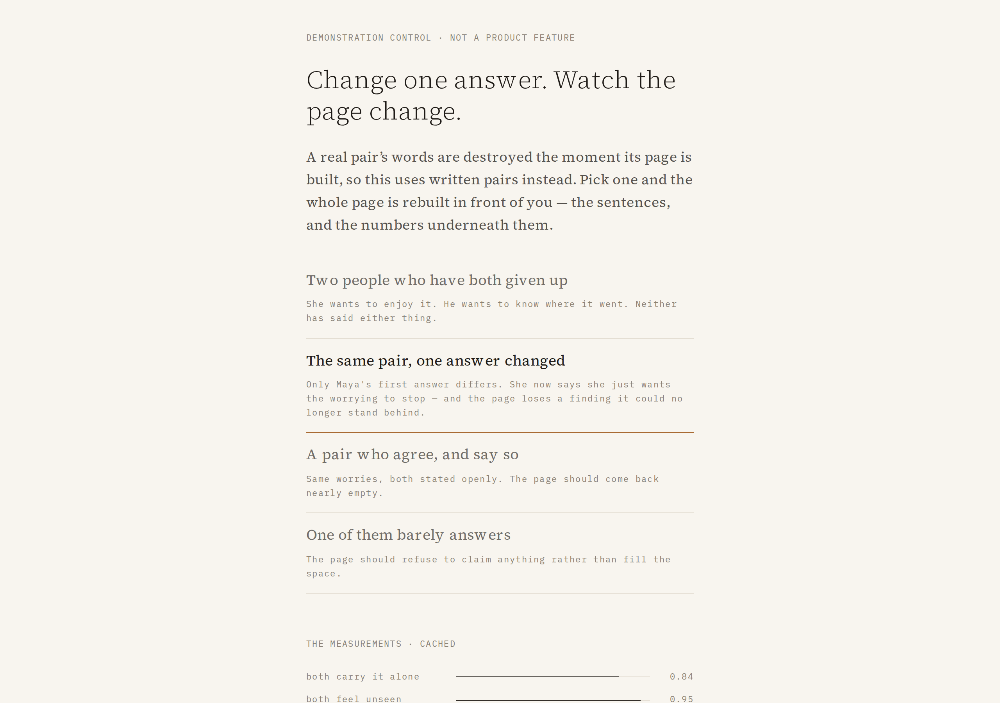
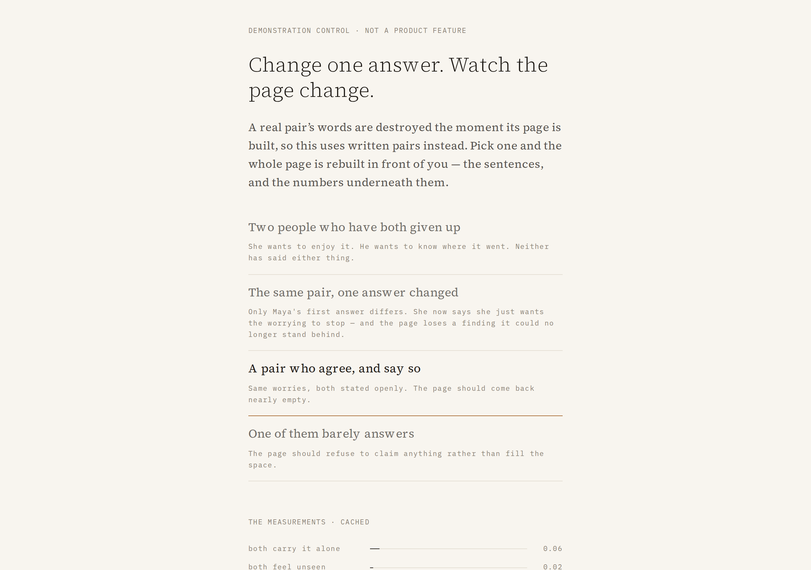

# Ours

**56% of couples argue about money. They don't argue about the money.**

She thinks he's careless. He thinks she hides spending. Both are partly right, and neither
is the argument. The real subject is almost always something nobody has said out loud — and
it can't be, because getting there would mean going first.

Ours is a two-person app. Each partner answers six open questions **alone**, in their own
words. The page does not exist until both have answered. Then they open the same page, and
it tells them what they are actually disagreeing about.



> *You're both carrying it alone.*
> *Neither of you has said that out loud. You each think you're the one holding it.*


---

## Why this doesn't exist yet

Every product in shared finances answers an **information** problem, and asks you to solve a
**trust** problem before it can help.

To get a shared picture, someone has to link their accounts, or share a budget, or fill in
one side first. Going first feels like conceding — so it doesn't happen, so both people
argue from partial pictures, indefinitely.

The research behind this is in `devpost/scope.md`, and the short version:

- 56% of couples argue about money, and money is the most common source of conflict in a
  relationship — more frequent, more intense, and less resolved than other arguments.
- 58% of couples don't contribute equally, and nearly **1 in 4** say that imbalance affects
  the relationship (Fidelity's 2026 Couples & Money study).
- 74% of couples sit in a pursue-withdraw pattern, where the more anxious partner chases and
  the other withdraws — a pattern that money conversations reliably trigger.
- Money conflicts are rarely about the amount. They are about *what the money means* to each
  person, which is private, which is why they cannot be settled by sharing data.

That is the gap. The information is the easy half. Nobody has solved the other half, because
the thing that makes it hard — nobody will go first — is exactly what every current design
assumes away.

## What it does

| | |
|---|---|
|  | **Start a pair** and get a code to hand to someone else. |
|  | **Answer six open prompts alone.** No amounts, no categories, no dropdowns. |
|  | **Seal.** A hash of your own words, shown before you commit, and a plain statement of what happens to them. |
|  | **Wait.** The page doesn't exist yet, and neither of you can hurry the other. |
|  | **Both open the same page.** Plain sentences, each carrying the number behind it. |
|  | **Tap any line** to see the measurement and your own words. |

And then one thing:



### Two things worth noticing

**A finding below the bar is absent, not softened.** There is no hedged version of a
sentence. If the number isn't strong enough, the page leaves it out. On a deliberately
healthy, aligned couple the page comes back nearly empty — see the
[demonstration control](#prove-it-actually-depends-on-what-you-wrote).

**Your partner's words cannot be shown to you, because they no longer exist.** When the page
is built, both sets of answers are deleted in the same transaction that stores it. The words
you see under your own findings come from your own browser, which is why the promise survives.
`pnpm e2e` checks this from outside by reading the database directly.

## The interesting technical decision

**There is no language model in this product.**

TypeSafe's System One returns *calibrated probabilities*, not text. Code decides what they
mean and writes the sentence. That is not a constraint we worked around — it is the reason
the page can be trusted.

The alternative was the obvious one: send the answers to an LLM and print what it says. That
would have produced a page that reads like every other AI product — plausible, slightly
generic, and impossible to check. This way, every line on the reveal is a claim that was
actually measured, and the numbers are visible underneath.

It also changed the design. The whole interface is one idea: **the human voice is typeset
like a letter, and the machine's judgments are typeset like evidence.** Ink serif for
anything a person said; a small ochre mono for anything a model measured. The division of
labour is visible without a word of explanation.

### Why the questions are narrow

The first version asked one broad question — *are these two people worried about the same
thing?* — and it was unreliable. It returned **0.37 confidence** and disagreed with itself
across runs about people whose answers plainly disagreed.

Asking the specific question instead — *is one of them driven by wanting to enjoy money while
the other wants certainty?* — returns **0.85** on the target pair against **0.04** on a
healthy aligned couple.

| | target pair | same worry | aligned | dismissive |
|---|---|---|---|---|
| both carrying it alone | 0.82 | 0.95 | **0.06** | 0.00 |
| both feel unseen | 0.70 | 0.06 | **0.02** | 0.00 |
| enjoy vs. control | 0.85 | 0.10 | **0.04** | 0.00 |
| shown | 3 movements | short page | **nothing** | short page |

The product only says what it actually asked about. Those thresholds were set from these
numbers, not from taste, and `pnpm seed` re-runs the whole table — if the aligned pair ever
produces a finding, the build has drifted and the product is making claims it should not.

## Prove it actually depends on what you wrote

Real pairs have their words destroyed the moment their page exists, so there is nothing real
to re-derive from. The demonstration control therefore uses written pairs, and says so on
screen so it can never be mistaken for a feature.

Change one answer and the page loses a finding it can no longer stand behind:



`enjoy_vs_control` falls from **0.85 → 0.09**, and *"You're not arguing about the
restaurants"* disappears — because the sentence is only ever printed when the number that
licenses it is there. Switch to a pair who agree and say so, and the page comes back empty:



## This was built with the Devpost Learn Skill Pack

`npx skills add challengepost/learn-ai-basics --all -y`, then `1-start` → `6-ship`. The
planning documents it generated are in the repo, because they are the more interesting part
of the artifact:

- **`devpost/scope.md`** — the competitive analysis, the kernel, and what was deliberately
  cut with reasons.
- **`devpost/prd.md`** — the journey, every state including the ones nobody wants, and the
  measured numbers behind each finding.
- **`devpost/spec.md`** — architecture, data model, and the plain-language version you could
  read aloud to someone.
- **`devpost/checklist.md`** — the build sliced so each step was usable, with **nine
  revisions recorded** where reality contradicted the plan.

Two of those revisions are the most useful thing in the repo, because they are honest:

> *The pair code was never surfaced anywhere after creating a pair.* The PRD's core journey
> says two people join the same code, but the app generated one and then never showed it to
> anybody. Found by using the app, not by any check.

> *The first version of the "one answer changed" demonstration variant did not actually
> change the page.* It moved the numbers but kept all three movements, so the beat it was
> supposed to demonstrate was invisible. Tuned against the live model until the movement
> disappeared.

The planning was not decoration before the code. It changed the code — twice, in ways the
plan itself could not have predicted.

### On cognitive debt

The stated problem with AI-built apps is code you can't explain or maintain. The countermeasure
here is structural rather than a promise: **every English sentence in the product is in one
file, `src/lib/compose.ts`, which imports nothing and does no I/O.** You can read the product's
entire voice top to bottom in about a minute. Numbers go in, sentences come out, and there is
no path by which a sentence reaches the screen except by clearing a threshold in that file.

## Run it

```bash
pnpm install
cp .env.example .env      # add a key from https://console.typesafe.ai/keys
pnpm dev                  # http://localhost:3000
```

Open it in a normal window and a private window, join both with the same code, and answer as
each person. The second submission builds the page.

| | |
|---|---|
| `pnpm seed` | The pipeline on a real pair, then three controls that must come back silent |
| `pnpm e2e` | The full loop over HTTP, ending in a direct read of the database |
| `pnpm e2e:live` | The same loop against the deployed URL, verified through the API |
| `pnpm capture` | Regenerates the screenshots above |
| `pnpm typecheck` | `tsc --noEmit` |
| `pnpm deploy` | Builds and deploys to Cloudflare Workers |

**Live:** <https://ours.kiter0211.workers.dev> — open it in two different browsers, or a
normal and a private window.

**Stack:** Next.js 15 (App Router) · TypeScript · Tailwind v4 · Cloudflare Workers + D1 ·
TypeSafe System One · Playwright. `pnpm install` compiles nothing.

### One store, two drivers

`src/lib/db.ts` is written against a single small interface. Which driver runs is decided in
one place:

- **locally** — Node 22's built-in `node:sqlite`, one file at `data/ours.db`, nothing to
  install and nothing to run
- **deployed** — Cloudflare D1, through the `DB` binding in `wrangler.jsonc`

The SQL is identical in both, so every route above the store is unaware of which is running.
D1's `batch()` is atomic, which is what `storeRevealAndShred` wants: the finished page and the
deletion of both people's words land together or not at all.

The local driver is not a stand-in for a real deployment and is not presented as one. A file
does not survive between serverless invocations, so the deployed build has to bind a database,
and it does.

## What is real, and what isn't

- Every measurement is a real call against the TypeSafe API. Locally, responses are cached on
  disk keyed by a hash of the request, so a second run of any script makes no network call
  and produces identical numbers — the demo video can be recorded with the network switched
  off. Workers has no writable filesystem, so the cache switches itself off there rather than
  failing a request; every deployed number is a live call.
- The commitment hash is tamper-evidence for the person who wrote the answers: it proves what
  arrived is what they sent, and that it cannot be quietly rewritten. It is **not** a
  zero-knowledge proof against a hostile server, and the product does not claim it is.
- Not built, on purpose: no bank connections, no accounts, no notifications, no history, no
  voice input. See `devpost/prd.md > Non-Goals` for each with its reason.

## Licence

MIT — see [`LICENSE`](LICENSE). The Devpost Learn Skill Pack is included unmodified under
its own MIT licence, as the hackathon requires.